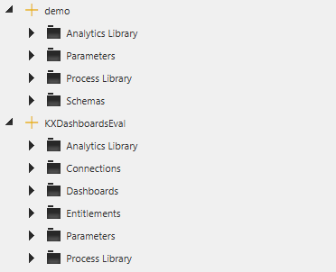

# Lesson 2.1 - What Is a Delta Control UI?

_Module 2: Delta Control · ~TBD min_

## Introduction

This lesson defines what the Delta Control UI is and a high level overview of how to use it.

## Key Concepts

KX Control (also called Delta Control or just DC) is the central management console for a Delta Platform application. It is the main source of information for everything that is running through the application. It lists all of the processes, instances and services that are running, and gives the ability to click through each of them to view their properties in a more friendly way than using the traditional file system structure.

Everything in a system — from data schemas to running processes to user permissions — is represented as an entity. There are numerous different types of entities, and each of them has a specific template associated with it to help you create a new instance of them.

Think of it as the control room for your entire data platform: rather than editing configuration files or running commands directly on servers, you use Control's UI to define, deploy, and monitor the pieces that make up your system.
