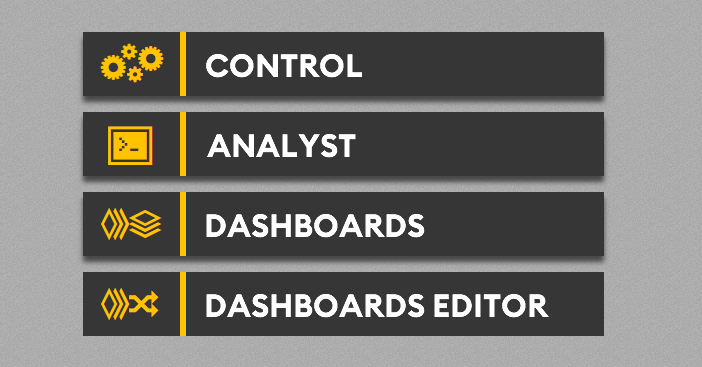
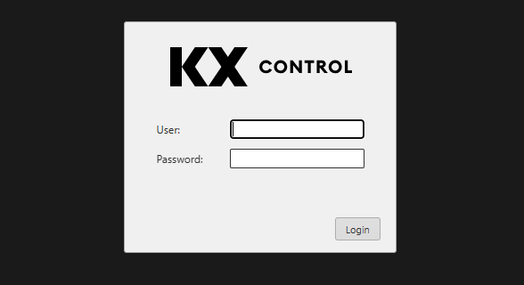
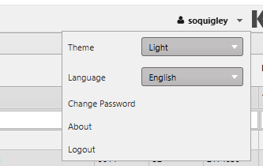

# Lesson 2.2 - Logging In

_Module 2: Delta Control · ~TBD min_

## Introduction

This lesson details how to log in to the platform.

## Key Concepts

When you access the application, you will first be greeted with the splash page that has links to Control, Analyst, Dashboards and Dashboards Editor. For this module, click on Control which will bring you to the KX Control login page. We will cover the other links in another module.

To login, use the User name and Password that you have been provided.

Once you are logged in, you should be able to see your username in the top right hand corner of the page, next to the KX Control logo. If you click on the user name, you will be presented with a dropdown where you can toggle the Theme (Dark/Light) and the Language.

When you log in to Control, the interface is organized into three main areas:

1. Navigation Tree - this appears on the left hand side of the screen.
2. Viewers Pane - this by default will show the 'Process Library Status' viewer but can be used to show other types of views.
3. Editors - this panel is used to inspect and edit the various properties the entities in the platform.
