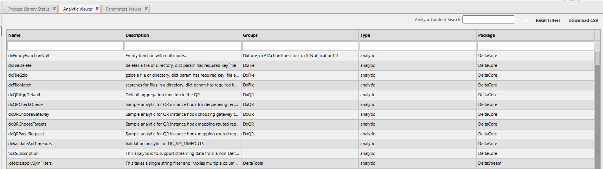
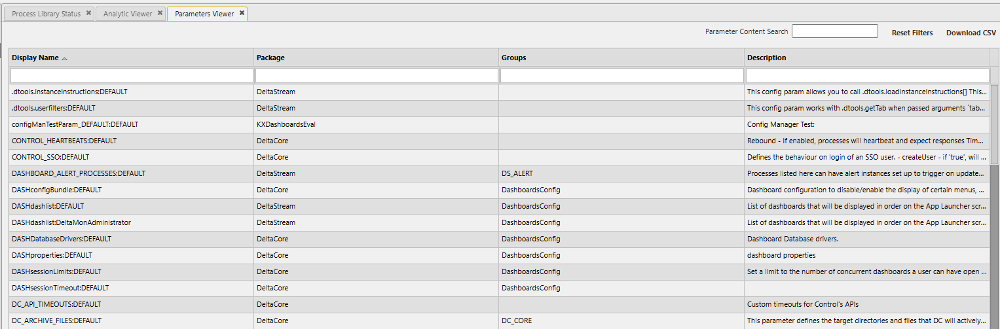

# Lesson 2.4 - Viewers

_Module 2: Delta Control · ~TBD min_

## Introduction

This lesson defines what Viewers are and how to use them.

## Key Concepts

Viewers give you a "quick view" of entities and their statuses without opening anything for editing. They can be handy if you are looking for a particular reference to something within an analytic or a config parameter, or if you want to look at the Action Tracker Library and see how all of the different actions and transitions link together.

To access any of the viewers, go to Tools > Open Viewer on the top left of the screen, and you will see the list of all of the possible viewers. A few worth looking into in detail are:

- **Analytic Viewer** - this allows you to search the contents of all of the analytics for a particular expression. It can be useful in identifying all analytics that match a reference that you want to update or delete

  

- **Parameters Viewer** - allows you to search to find a match across all the parameters in the system.

  

- **Navigator** - this replicates the Navigation Tree on the left hand side, but will reproduce it if you accidentally close it
