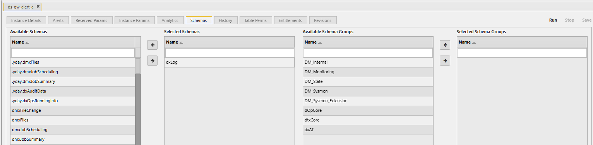

# Lesson 2.5 - Editors

_Module 2: Delta Control · ~TBD min_

## Introduction

This lesson defines what Editors are and how to use them.

## Key Concepts

The Editors allow you to make changes to the entities of the application. You can single click on any Instance or Task from the Process Library Status, or you can double-click on any entity from the Navigation Tree on the left. The type of entity that it is will determine what the Editor looks like. For example, an Instance will have an Instance Params tab, whereas a Service will have a Service Params tab.

With the Editor open, you can update:

- **The Reserved Params** - this is the host, port and taskset of the entity. This is common across most of the entities.

  

- **Instance/Service Params** - these are the attributes that are specific to the type of entity selected.

  

- **Analytics & Schemas** - these are the entities that the process/service will have visibility to when it is started up. Instead of loading in something during the initialization, you can specify the entity or entity group here and it will be automatically loaded n to the namespace of the entity when it starts up.

  
