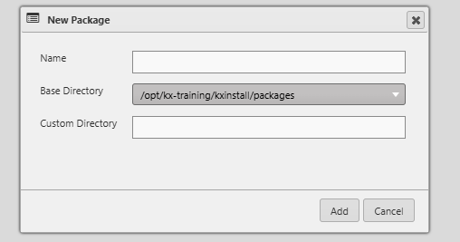

# Lesson 3.2 - Creating and Populating a Package

_Module 3: Packaging and Deployment · ~TBD min_

## Introduction

This lesson defines how to create a new package and how to add entities to the new package.

## Key Concepts

New packages are created from **File → New → Package**. You'll be asked for:

| Field | Description |
|---|---|
| Name | The name of the package |
| Base Directory | The parent directory the package will be saved under (a limited set of options are available) |
| Custom Directory | An optional subdirectory under the base directory |

Once created, the package appears in the Navigation panel and can be opened in the **Package Exporter**, which can be found under the Tools dropdown in the top left of KX Control.

### Adding entities to a package

There are three ways to add entities to a package:

1. **Drag and drop** — drag entities from the Navigation panel directly into the Package Exporter.
2. **Assign on creation** — when creating a new entity, associate it with a package straight away.
3. **Bulk-assign from Unpackaged Entities** — multi-select several unpackaged entities, choose a target package, and add them all at once.

Once entities have been added or removed in the Package Exporter, click **Save** to update the package definition, and use **Export All** to make sure the on-disk XML representation matches the current state.

- Clicking Save will move the entities into the package, but will not update the on-disk reference to them
- Clicking Export All will update the UI and the on-disk reference at the same time

### Package Design

You will notice in most deployments of Control that packages are named after specific features of an application, like FileLoader or TradeDashboard. This is a common development practice used for deployments. Each entity that is needed for a specific goal or outcome will be packaged together. This way it makes the deployment very portable, as you can add in and take away different components of the application with ease. The benefits of this are:

- Lighter imports: with every packages separately, you do not need to import one large package for a small change. You only need to import the affected package(s).
- UI only deployments: if you package the UI elements separately to the rest of the application, you can do a deployment of the UI components without having to deploy the rest of the application. Therefore you can test out UI changes without having to wait for the non-UI components to install every time, which can be time consuming.

---

> **Reviewer notes from source notebook (not lesson content):**
>
> @Guan - Can we all use delta_training_1_0_0 as the demo package and all other lessons align to this. DeltaStream can confused people and that is a kx package, don't want them touching it.
> ~ Stephen - updated.
