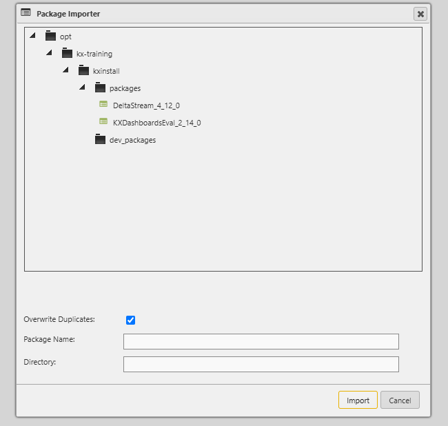
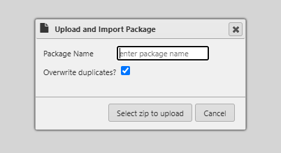

# Lesson 3.3 - Importing Packages

_Module 3: Packaging and Deployment · ~TBD min_

## Introduction

This lesson defines how to use the Package Importer to bring new packages into the application.

## Key Concepts

Packages are brought into an environment using the **Package Importer** (available from the Tools menu or an entity's context menu). The importer lists both packages that are already imported and packages that are available to import but haven't been yet.

There are five ways to import a package:

| Method | When to use it |
|---|---|
| Import from available packages | The simplest case - select an already-visible package and choose which entities to bring in |
| Import from the different location | Point the importer at a different directory on the server that contains the package |
| Import from a local ZIP | Upload a ZIP file containing an exported package structure to the server and import it directly |
| Import a new Git repository | Clone a Git repository containing a package for the first time (see Lesson 3.4) |
| Git update an existing package | Pull the latest changes for a package that's already linked to a Git repository |

Because KX Control supports multiple packages inside a single directory or Git repository, you may need to choose which specific package to import from a list of candidates.

The most common way of importing a package is the first method listed, where the package already lives in the `<install_directory>/packages` directory on disk, and just needs to be imported. You can use the window on the right hand side to decide which entities you want to import, they do not all have to be imported at the same time.

If you wanted to import a different version of a package that was already installed, you would likely need to use the 'Import From' option. This will list out all of the packages in the `<install_directory>/packages` directory, including any duplicates of the same package name and their associated version number

For smaller packages, like ones that contain a single entity or some small number of configs, you can simply keep them as a zip file and use the 'Import Package Zip' option. This will look at your downloads folder on your computer for packages to import. Packages need to have a specific structure, so it is generally advised to only import packages on to the application that have previously been exported from a KX Control application.

### Duplicate Entities

If you are customizing entities that come with the standard version of Delta Control, you will most likely end up editing the entity and adding it to a new custom package. On the UI it will look like that entity only exists in one package, but on disk the original un-edited entity still exists. If you re-imported the original standard package, this would overwrite the custom changes made in the UI and revert the entity back to its original version and package. The changes are not lost, assuming the custom package had been exported before the original package was re-imported. It is important to remember the difference between what is present in the UI (i.e. in memory), and what is actually on disk.

### Debugging the Import of Packages

It is important to know how the packages are imported into Control, in case you ever come across an issue with the version of an entity that was imported. The package imports are done by Control itself, so it is the DeltaControl.log that you need to look at to figure out which packages were imported and in which order. A snippet of the DeltaControl.log is below, showing the important lines (and some were edited for brevity). In this log you can see the order in which packages are imported, and which entities in each package are imported. It is very handy if you think a certain version should have been imported and it wasn't.

> **Note:** the source notebook references a DeltaControl.log snippet here ("A snippet of the DeltaControl.log is below"), but no log snippet or screenshot is actually present on the page — likely dropped during editing. Flagging as a content gap rather than guessing at the content.

---

> **Reviewer notes from source notebook (not lesson content):**
>
> @Guan - wonder if we should mention that if an entity is in 2 packages, the later import will force it under the last package. For example, DeltaStream processes having its default configuration overwritten in our test package and hence it will belong to test package
> @ Stephen - done
>
> @guan - maybe add deltacontrol.log as example of how the imports like, good debugging
> @Stephen - done
