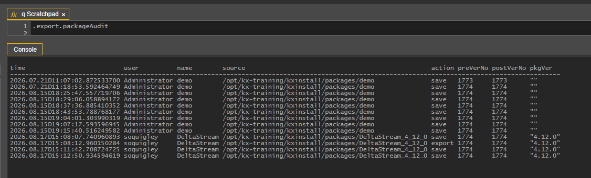

# Lesson 3.4 - Exporting Packages and Git Integration

_Module 3: Packaging and Deployment · ~TBD min_

> **Note:** the source notebook's body heading says "Lesson 3.1 - Exporting Packages and Git Integration" (a typo in the original — the page/nav title is 3.4, used here).

## Introduction

This lesson defines how to export packages and how to integrate Git.

## Key Concepts

Packages can be exported in two broad ways: **locally** (as a ZIP file, or to a directory on the server) or **via Git**. Depending on the setup of the application, it may not always be possible to integrate Git directly into KX Control. An alternative to this is to set up a Git repository on the server, and copy across the files from the locally exported package.

### Local Export Options

- **Export locally** — downloads a ZIP of the package's current on-disk contents to your browser (run *Export All* first to make sure it's current).
- **Export with options** — export to a custom location, either elsewhere on the server or a manually entered path. This is also where you can clean up entities that have since been deleted.
- **Export all** — synchronizes the on-disk XML representation with the live state of the package.

### Git Integration

If you would like to use the in-built Git integration tool, more details can be found in the KX product documentation (link not captured from source — canvas-rendered page, no extractable URL).

### Auditing

Every import, export and save of a package is tracked automatically in the **.export.packageAudit** table, and history for a specific package can be retrieved with **.export.getAuditHistory[PackageName]**.



![q Scratchpad showing the query .export.getAuditHistory[\`DeltaStream] and its console result: a filtered table of audit history rows for the DeltaStream package](images/3.4-audit-history-query.png)

### Configuration files

Included in every package is a `<package_name>.cfg` and a `<package_name>_export.cfg` file. You won't see these in Control but they will be on disk in each of the package directories.

- The .cfg file defines the list of entities which are part of the package and also the name of the package in Control. The name of this file must match the name of the package before the first `_`.
- The _export.cfg file is used when the package is imported into Control. Only the entities in this file will be imported into Control. Normally, the contents of these two files are identical.

### Configuration Directory

Each package is required to have its own configuration file. This file lists out the dependencies that any package might have, as well as providing an optional list of environment variables that should be written down to the delta.profile during an install. This directory must be present for any package to be imported or installed.

The directory needs to be named install_config, and will live alongside the other entity directories. Within that there needs to be a profiles directory, and inside that the `<package_name>.install.config` file. The structure of the file should be something like the below:

```
DEP|DeltaStream
ENV|Variable Name|Variable Type|Variable Default|Update Option (0 or 1)
```

More information can be found about the configuration directory (link not captured from source).

---

> **Reviewer notes from source notebook (not lesson content):**
>
> @guan - good with this but might not be relevant in AI world once we have a first commit.
> @ Stephen - done
>
> Separately, do mention the .cfg files which are important to package design
> @ Stephen - done
