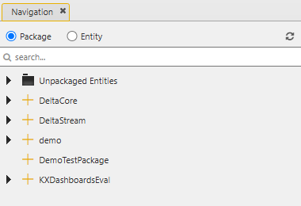

# Lesson 3.5 - Naming Conventions

_Module 3: Packaging and Deployment · ~TBD min_

## Introduction

This lesson defines what the normal naming conventions are for naming packages and entities.

## Key Concepts

KX Delta Platform naming conventions apply at a few different levels: the **deployment package** level (for installable .tgz bundles), the **Control package** level (for packages managed inside the KX Control UI), and general **q/kdb+ coding conventions** for the entities and code you write inside them. It's worth understanding all three since they will all apply at some stage of the development lifecycle.

### Deployment package naming

Installable platform packages (the .tgz bundles produced when building a custom package for deployment) follow a strict naming pattern:

```
PackageName_MajorVersionNumber_MinorVersionNumber_IncrementalVersionNumber_BuildTimestamp.tgz
```

For example: `DeltaStream_4_5_0_200231082608.tgz`. The PackageName is simply the text before the first underscore, in this case DeltaStream. This matters because the install scripts locate a package's configuration files (.cfg, _export.cfg, _permissions.xml) by package name, so getting this wrong will cause the install process to fail to find them. If any of your packages do not have these .cfg files, they will not be visible to the Package Importer either.

![Terminal showing `ls platform-training/PlatformKx-4.12.1-Linux/packages/` listing .tgz deployment packages such as AnalystUI_4_12_0_250929160856.tgz, ControlNewUI_4_12_0_251107210335.tgz, DeltaAppServer_4_12_0_251107212335.tgz, DeltaConnect_4_12_0_251104202248.tgz, DeltaControl_4_12_0_251204130031.tgz, DeltaStream_4_12_0_250829134130.tgz, InsightsCore_4_12_0_250605.tgz, KXDashboards_2_14_0_251030151004.tgz, KXDashboardsEval_2_14_0_251030151004.tgz, KxPlatformAPI_4_11_0_250605125845.tgz, Tomcat_10_1_48_251103.tgz, and PyKX_3_1_5_20251029.tgz](images/3.5-package-ls-example.png)

### Control package naming

For packages created and managed inside KX Control itself (as covered in Lesson 3.2), the convention is simpler: name the package after the **solution it contains**, using **camelCase**, with **no spaces**. You can capitalize the first letter of the package name as well, so that it aligns with the other deployment packages.



### General coding and entity naming practices

KX Delta Platform is built on top of kdb+ and the q language, so the entities you build (analytics, functions, schemas) are ultimately q code. A few practices are worth adopting from day one, both from the platform's own design principles and from established q coding conventions used across the kdb+ community:

- **Use descriptive names, not abbreviations.** Every entity in KX Control has descriptive fields (name, description) — populate them as you go. Future developers (including future you) will thank you.
- **Use environmental parameters, not hard-coded values.** File paths, IP addresses, ports and similar values should be parameterized so a system can move between environments (dev, test, prod) without code changes.
- **Keep global and local variables visually distinct.** A common q convention is to start global (read/write) variables with an initial capital letter and use short, lower-case nouns for local variables, reserving x, y, and z for a function's positional parameters.
- **Avoid dots and underscores in identifiers where possible.** In q, a dot in a name looks like — but isn't reliably treated as — a namespace separator, which can cause confusion or subtle bugs. Similarly, avoid trailing underscores, since they can be visually confused with the built-in _ (drop/cut) operator.

---

> **Reviewer notes from source notebook (not lesson content):**
>
> @guan I like the mentioning of environmental variables, can mention api and package design that will add env var to delta.profile
> @ Stephen - mentioned in the previous section
