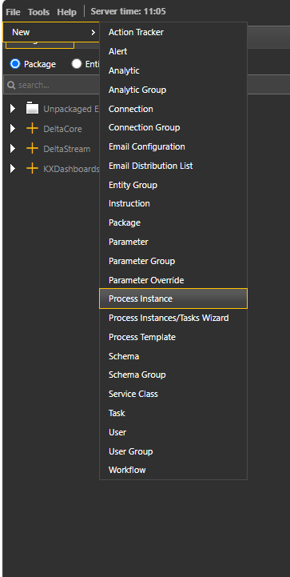
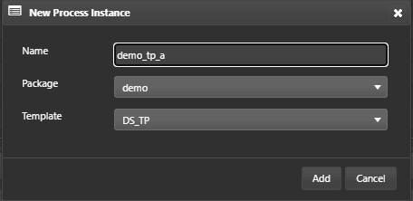

# Lesson 4.3 - Creating the TP, RDB and HDB Instances

_Module 4: Process Templates, Instances and Workflow Assembly · ~13 min_

> **Note:** the source notebook's body heading says "Module 3" (a typo in the original — the page/nav title is Module 4, used here).

## Introduction

This lesson creates the TP, RDB and HDB instances that will act as the core of the system.

## Key Concepts

Every instance in this lesson is created inside the `ref_loader` package and named per this course's naming reference sheet: `demo_tp_a`, `demo_rdb_a`, `demo_hdb_a`.

### Step by Step Process Creation for TP

The process instances documentation lays out a fixed sequence for creating an instance from a template.

> **Video placeholder in source:** the notebook has `[Add video based off below steps]` directly above this walkthrough, with a reviewer note confirming a video is planned once formatting is agreed — this is a strong candidate for the Playwright video walkthrough stretch goal.

1. Login to Delta Control and navigate to File -> New -> Process Instance in the top left hand side of the screen.

   

2. Name the process `<process name>`, and add to `<package name>`. For Template, select the DS_TP template.

   

3. *(continued from the dialog above — Add / Cancel buttons shown)*

4. Instance Params: Navigate to Instance Params and apply the following configuration:

   | Parameter | Value for Course | Description |
   |---|---|---|
   | publishChannel | demo_tp | Channel to publish all tables |
   | subscriptionChannel | demo_channel | Channel to subscribe to |
   | logDirectory | ~/kx-install/delta-data/DeltaDemoData/tplog | Directory to log data to (tplog), set to NO_DIR for no log file |
   | pubFreq | 0 | Time interval in milliseconds between publish events in the TP |
   | eodTime | 00:00 | Time EOD occurs at |
   | initialStateFunction | dxEmptyFunctionNull | Analytic to run on startup. |

5. Configure the **reserved parameters**: In the **Reserved Parameters** tab, review and update the template's default parameters.

   | Parameter | Value for Course | Description |
   |---|---|---|
   | Host | localhost | Host name for process |
   | Port | 9310 | Port for process |
   | Taskset | | Taskset for process |
   | Heartbeat Frequency | | Frequency in ms for heartbeat with Delta Control |
   | Heartbeat Timeout | | Timeout in ms for heartbeat with Delta Control |

6. Finally, click save on the top right corner.

7. *(step left blank in the source notebook — no further instruction given)*

### Key Parameters for Course

**RDB**

| Parameter | Value for Course | Description |
|---|---|---|
| subscriptionChannel | demo_tp | Channel to subscribe to. Should be consistent to the tp publish channel. |
| initialStateFunction | dxInitialDataState | Analytic to run on startup. Covered in further detail in Lesson 7. |
| realTimeMsgFunct | dxUpdInsertPub | Update function to be used by rdb. Covered in further detail in Lesson 6. |
| logReplayFunct | dxLogReplay | Analytic to replay the ticker plant log. Covered in further detail in Lesson 6. |
| eodFunct | dxEODSaveAndDelete | End of day function (e.g. to write to hdb) |
| hdbProcess | demo_hdb_a | Name of historical database to save to at EOD |
| tableEodList | DS_TABLES_EOD_LIST:DEFAULT | Configparam consisting of tables to perform EOD operation on. |

**HDB**

| Parameter | Value for Course | Description |
|---|---|---|
| directory | ~/kx-install/delta-data/DeltaDemoData/hdblog | HDB Directory |
| initialStateFunct | dxEmptyFunctionNull | |
| reloadFunct | dxEmptyFunctionNull | Function called when HDB is reloaded |

---

> **Reviewer notes from source notebook (not lesson content):**
>
> @guan For some of the init/funct, might want to explain what is a typical setup or in the purpose of this demo, with real or explainable psuedo code
> I was also hoping that you earmark videos for an actual configuration of a process we want in our demo, for example tp, rdb, hdb
>
> CB: Placeholder for video added - video to be created once we agree on formatting etc. Added a note for the init/upd funcs to be covered in lesson 6.
