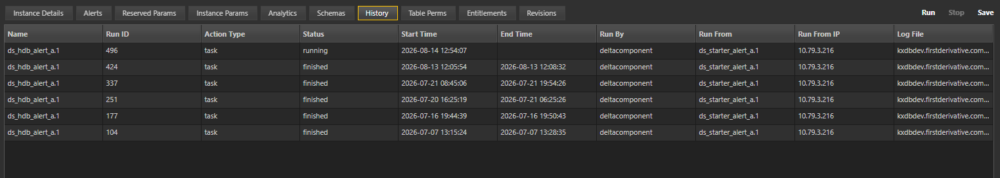

# Lesson 4.4 - Additional Process Configuration

_Module 4: Additional Process Configurations · ~8 min_

> **Draft outline preserved from source** (appears above the finished lesson on the same notebook page, likely an early summary that was never removed):
>
> - **Alerts** — shutdown/heartbeat alert types (expected shutdown, unexpected shutdown, heartbeat timeout) and the action each triggers.
> - **Analytics** — the analytic group(s) bound to this instance.
> - **Schemas** — the schema group(s) bound to this instance.
> - **History** — a record of the instance's past runs and changes.
> - **Entitlements** — access control for the instance; not covered in this course.
> - **Revisions** — versioned snapshots of the instance's configuration.

## Introduction

Lesson 4.3 covered configuring Reserved and Instance Parameters. This lesson will cover the additional configurations that can be done in Delta Platform.

## Key Concepts

### Alerts

The Alerts tab configures how the platform responds when an instance's running state changes unexpectedly.

There are three trigger conditions available:

| Trigger | Definition |
|---|---|
| **Normal Expected Shutdown** | Normal shutdown via task completion or user request |
| **Unexpected Shutdown** | Process crashed, server died, or shutdown was not requested |
| **Heartbeat Timeout** | Process stopped sending heartbeats to Control |

The following responses can be configured for the above triggers:

| Response | Description |
|---|---|
| No action | No action |
| Restart this instance | Process is restarted. Number of retries and time between retries is configurable. |
| Run new Instance | New process is started (instance name is configurable) |
| Run workflow | Workflow is started (workflow name configurable) |

### Analytics

The analytics tab section gives the user the ability to bind analytics and analytic groups to a process, enabling the process to load these into the process on startup. This will be covered in further detail in Section 5.

### Schemas

The schema tab section gives the user the ability to bind schemas and schema groups to a process, enabling the process to load the binded schema definitions into the process on startup. This will be covered in further detail in Section 5.

### History

The History tab provides a read-only record of the instance's past lifecycle events such as starts, stops, parameter changes, and who made them. It is the audit trail for a single instance's operational history, distinct from the platform-wide logging covered in Lesson 4.5. No configuration is needed; it populates automatically.

An example of the history tab is shown below:

### Entitlements

The Entitlements tab controls access to the instance at the platform level. Entitlements will not be covered in this course.

The following entitlements are available in Delta Platform:

| Access Level | Description | Link |
|---|---|---|
| Read/Write | Allow read and write access to the entity | https://code.kx.com/platform/latest/entitlements.html#set-entity-permissions |
| Read | Allow read access to the entity | https://code.kx.com/platform/latest/entitlements.html#set-entity-permissions |
| Read/Deny Write | Allow read access to the entity and deny write | https://code.kx.com/platform/latest/entitlements.html#set-entity-permissions |
| Deny All | Deny all access to the entity | https://code.kx.com/platform/latest/entitlements.html#set-entity-permissions |

### Revisions

The Revisions tab stores versioned snapshots of the instance's configuration. Each save creates a new revision, and earlier revisions can be restored if a parameter change needs to be rolled back.

> **Video placeholder in source:** `[Example video of restoring and comparing diffs]` — another candidate for the Playwright video walkthrough stretch goal.

---

> **Reviewer notes from source notebook (not lesson content):**
>
> Entitlements - Guan since you mentioned, provide access levels possible but don't go indepth
