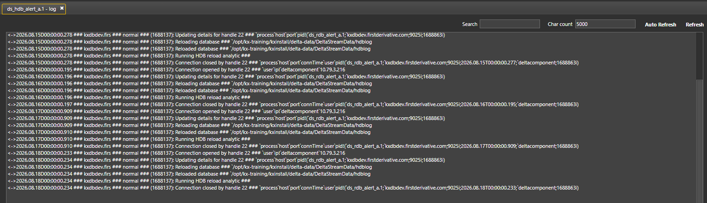

# Lesson 4.5 - Operating a Process: UI

_Module 4: Process Templates, Instances and Workflow Assembly_

## Introduction

This lesson starts, stops, attaches to, and reads logs from the three instances built in Lesson 4.3 using the DC UI.

## Key Concepts

### The instance-level actions

The process instances (https://code.kx.com/platform/latest/process_instances.html) lists Start, Stop, Attach, and View Log as direct instance-level action. Each is available from within the package's process list, or from the **Process Library Status** viewer.

> **Missing image in source:** `[image of start/stop button from process library and from process instance]` — placeholder text only, no actual screenshot present.

### Viewing Logs via the UI

> _(Source heading included an inline reviewer note: "@Guan mention a good practice is to do rolling" — addressed in the text below.)_

The **View Log** action in the Process Library Status opens the log file for the selected instance in the DC UI's built-in log viewer. The log file itself is written to the directory configured by the `FD_LOGDIR` environment variable - the same file that Lesson 4.5.5 tails directly from the command line.

To prevent log files from becoming excessively large, log rolling can be configured on a per-process basis via the rollMode parameter (https://code.kx.com/platform/latest/logging.html#log-file-rolling).

Two rolling modes are available:

size: Rolls the log file once it reaches the size specified by the rollSize attribute (in megabytes).
daily: Rolls the log file automatically at the time configured in rollTime.

### Attaching To a Process

> _(Source heading included an inline reviewer note: "Guan mentioned that this is not ideal in Production but is a kdb developer practice due to interpreted language".)_

"Attach" connects to an active process for monitoring or debugging. For a q process, attaching opens a live q console session against the running instance, using a KX Analyst Session.

**NOTE:** Attaching to a process should only be done in a development environment - you should/will never have access to attach to a process production!

> **Video placeholder in source:** `[Quick analyst session video]:` with the following storyboard, not yet recorded — a strong candidate for the Playwright video walkthrough stretch goal.
>
> 1. Show logs via console
>    1. Print log
>    2. Hide std out and print again
>    3. Clear all
>    4. Show source expressions
> 2. Opening variables/functions via workspace ui
>    1. Define new function
>    2. Open function through ui
>    3. Edit function and click save
>    4. Check contents via code
