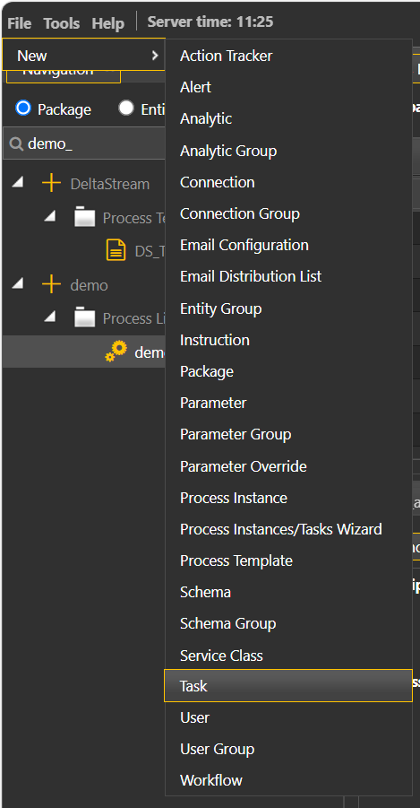
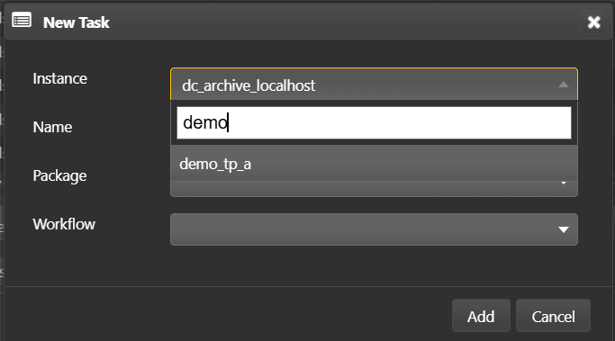
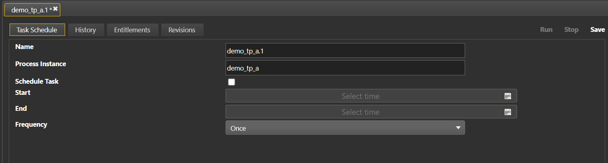

# Lesson 4.6 - Creating and Configuring Process Tasks

_Module 4: Process Templates, Instances and Workflow Assembly_

## Introduction

Lesson 4.3, 4.4 and 4.5 focused on the process instance. This lesson will focus on the process task, which is derived from a process instance.

## Key Concepts

A process task is a launchable, schedulable unit of a process instance. It can be used for scheduling tasks to run at specific intervals, and are also a prerequisite for running a set of tasks as workflows. Workflows will be covered further in Lesson 4.7.

### Configuring a Task

This section covers the creation of an example process task for the tp process instance created in Lesson 4.3.

> **Video placeholder in source:** `[Add video of steps below]` — another candidate for the Playwright video walkthrough stretch goal.

1. Go to file -> New -> Task

   

2. *(continued — Task selected in the New menu)*

3. Select the process to create a new task for (instance) and add to package and click add.

   

4. *(continued from the dialog above)*

5. Once created, save with default settings.

### Task Scheduling

After clicking a task, the first tab will be the task scheduler. This can allow for scheduling processes to start and stop at a specified time or run at a set interval. This has many use cases such as for daily reports or archival jobs. Running a process only for a set job allows for efficient use of resources.

