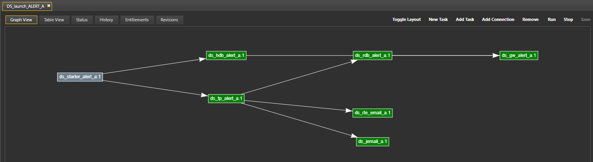

# Lesson 4.7 - Creating a Workflow

_Module 4: Process Templates, Instances and Workflow Assembly · ~8 min_

## Introduction

This lesson assembles the three instances - built in Lesson 4.3 and individually operable since Lessons 4.5 and 4.6 — into a **workflow**, using the connection model described in the KX Platform Workflows (https://code.kx.com/platform/latest/workflows.html), so they start together, in the correct predefined order, as a single action.

## Key Concepts

### What is a Workflow

KX defines a workflow as "A workflow is a list of tasks and connections between tasks." Each task in a workflow wraps a process instance, and "each task starts only once all its parent tasks are running successfully."

Per the naming reference sheet, this course's workflow shall be named as `<refdata_workflow_name>` and will be added to the course package.

Ordering in a workflow is expressed as **connections** between tasks, where a child task will not start until its parent task is running successfully.

A workflow is extremely useful when you want processes starting up in a specific order. For example, your publishers should never start before the tickerplant as you may lose messages. Beyond standard workflow chaining, the KX Platform supports sequential workflow startup during deployment. This lets you strictly control startup order, such as prioritizing the Messaging server workflow, which is essential for most processes.

### Example Step by Step

> **Note:** the source notebook marks this section `[Example step by step of creating workflow for this course]` as a placeholder, and row 3 of the procs table below is left blank/incomplete.

1. Create workflow Demo_launch_PROCS_A

2. Add procs in following order

   | # | Source | Destination |
   |---|---|---|
   | 1 | demo_tp_a | demo_rdb_a |
   | 2 | demo_hdb_a | demo_rdb_a |
   | 3 | *(left blank in source)* | *(left blank in source)* |

3. Save and start from process library status

4. Check status then stop from process library status

### Editing a workflow later

Workflows are not fixed once saved and can be edited after they are created and saved. We will be adding to this workflow as we create more processes over the duration of the course.

---

> **Reviewer notes from source notebook (not lesson content):**
>
> @guan, might want to add a reason for workflows, but this should be a straight forward topic. Might want to chain with sequencing of workflows
>
> @guan, might want to add a reason for workflows, but this should be a straight forward topic. Might want to chain with sequencing of workflows - CB: I think this is more advanced/on the deployment side?
> - Leave note on ms starting up first (2026/10/27 done)
