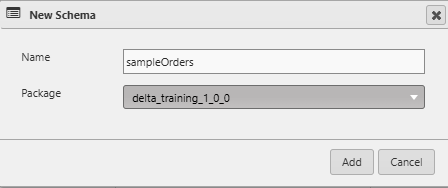
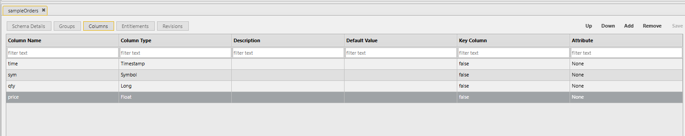

# Lesson 5.3 - Creating a Sample Orders Schema

_Module 5: Building the File Watcher Data Loader. ~10 min_

## Introduction

This lesson creates a sample orders schema that we will use to load data.

## Key Concepts

To be able to view our data in the HDB, we need a schema that defines the structure of the data so that the file watcher can detect if the csv being uploaded is correct. To create a new schema, you can go to File in the top left corner, select New -> Schema. We will call this schema 'sampleOrders', and put it into any of our custom packages.

Now we need to add the appropriate columns to match the sample CSV that we created earlier. So we will add a time, sym, qty and price columns with appropriate columns types

You can also add the Key Column and Attribute information here if it applies to your schema. Remember that key columns in a table make it into a dictionary, where the key is the key column(s), and the value is the non-key columns. This is particularly helpful for reference data, where you only want the latest information for a ticker. Table attributes are typically applied to tables to help speed up certain operations, such as searching. These are typically done when the table data is no longer going to change, but certain attributes, like grouped, can be applied to in-memory tables that are still updating.

---

> **Reviewer notes from source notebook (not lesson content):**
>
> @guan do explain the key column and attributes although its basic kdb, but good to know how delta manages this.
> @Stephen - done
