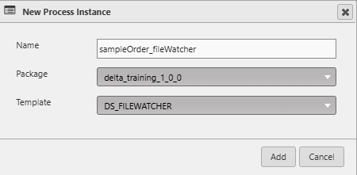

# Lesson 5.4 - Creating the File Watcher Instance

_Module 5: Building the File Watcher Data Loader. ~10 min_

## Introduction

This lesson creates the file watcher instance and task to be able to load in the sample data

## Key Concepts

When you create a process instance from the DS_FILEWATCHER template, these are the parameters you'll configure:

| Parameter | Type | Default | What it's for |
|---|---|---|---|
| initialStateFunct | Analytic | dxEmptyFunctionNull | Runs once, on startup |
| messagingServer | Configuration | DS_MESSAGING_SERVER | Which messaging server the File Watcher registers with |
| publishChannel | Symbol | — | The channel it publishes "file arrived" messages on |
| pollInterval | Integer | 30 | How often (in seconds) it checks the directories |
| fileListConfigName | Configuration | DS_FILEWATCHER_MATCHTABLE | Points to the config parameter holding your directory/pattern/analytic rules |
| consumerProcesses | Process Instance | — | Any processes that should be notified when a file is processed |

Following the same method as the previous lesson, let's create a new process called `sampleOrder_fileWatcher` from the DS_FILEWATCHER template.

For consistency, we will also create a Task for this process. Search for the newly created process in the top left corner. Right click on it and select 'New Task'. We don't need to add it to a workflow, but you can if you want to. It is best practice to only run Tasks as opposed to running the processes directly. You will notice in the vanilla setup that all of the running processes have Tasks associated with them. The other big reason for this is that you can't add Processes to workflows, you can only add Tasks.

Now that we have our instance and task, we need to create our DS_FILEWATCHER_MATCHTABLE config parameter. This will go in the fileListConfigName row of the file watcher. This config tells the File Watcher *which directory* to watch, *what filename pattern* counts as a match, and *which analytic* to call when a match is found.

| Column Name | Description |
|---|---|
| fileregex | What file name pattern to look for |
| directory | What directory to watch for new files |
| analytic | What analytic to run when a new file is found |
| alertTime | This can be left as the default value, 00:00:00.000 |

Create a configuration parameter using the DS_FILEWATCHER_MATCHTABLE config and call it 'sampleOrder_fileWatcherConfig'. To do this, we will override the default version. Search for the matchtable config in the top left, right click on the DEFAULT version of the config and then select Override. This will create a copy of the config with the necessary columns and their types already filled out for us. Overrides are useful because they allow us to create multiple copies of the same parameter with the same columns. If you change the DEFAULT version, you also have to change all of the overrides

---

> **Reviewer notes from source notebook (not lesson content):**
>
> @guan – do you think we have a good example of what an init function looks like for filewatcher?
> @Stephen - not really, I think we can leave it with using a read analytic to load the file in instead
>
> @Guan Have the above config info as a table
> @ Stephen - done
>
> @guan Explain why there is a concept of override
> @ Stephen - done
