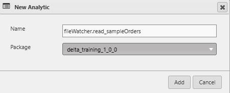
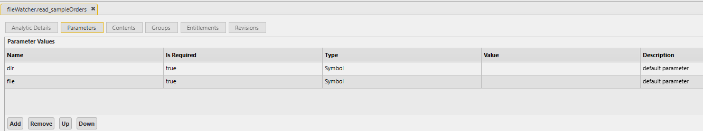

# Lesson 5.5 - Creating the File Watcher Analytic

_Module 5: Building the File Watcher Data Loader. ~10 min_

## Introduction

This lesson creates the file watcher analytic and how it is used to load data in

## Key Concepts

When the file watcher process detects a new file that matches the pattern specified in the MATCHTABLE config, it calls the analytic that is associated with that particular file regex. In our case that is the 'fileWatcher.read_sampleOrders' analytic. So let's build it out.

Create a new analytic and add it to our Demo package



This analytic will take two parameters, a directory and a file name, both of type Symbol. This matches what the File Watcher will pass to it when a match is found: the directory the file was found in, and the file's name. You should input the arguments to the function in the Parameters tab first before making any changes to the Contents. Any unsaved changes to the Contents when you make a Parameter change will be lost, so it is best practice to get your Parameters in order first before starting on the Content.



```q
{[dir;file]
  .log.out[.z.h;"Processing file";file];

  // Build the full path to the file
  path:.Q.dd[dir;file];

  // Load the CSV.
  // "NSJF" describes the column types in order: Timestamp, Symbol, Long, Float
  // enlist "," tells 0: to treat the first line as column headers
  orders:("NSJF"; enlist ",") 0: path;

  // At this point `orders` is an in-memory table you could:
  //   - publish onto a channel for downstream processes, or
  //   - save to disk as part of a historical database
  .log.out[.z.h;"Loaded row count:";count orders];

  // Extract date from filename for partitioning
  date:"D"$-4_ last "_" vs string file;

  //Save to disk
  hdbDir:hsym .utils.checkForEnvVar["ENV=DELTADATA_HOME=/DaaSData/hdblog"];
  hdbPar:.Q.dd[hdbDir;date;`sampleOrders,`];
  hdbPar set .Q.en[hdbDir; orders];

  .log.out[.z.h;"File load complete";file];
 }
```

A few things worth calling out for anyone new to this:

- 0: is q's "Load CSV" operator. The left argument ("NSJF", enlist ",") describes the column types and the delimiter; the right argument is the file path.
- This example loads the data in to memory, extracts the date from the file name, and then saves the data down to disk. This is the most common use of the file watcher, but you could also send the data to a downstream subscriber instead of saving it down.
- This analytic makes use of `.log.out`, which is an in-built API to KX Control. Logging is an important feature of analytics built for KX Control, and you can find more information here and here (links not captured from source — canvas-rendered page, no extractable URL).
- `.utils` is another useful module that contains sets of utility functions that you will see across the analytics in KX Control.
- The file watcher will run a function on a timer to see if the contents of all of the directories it is watching has changed. To see the functions that are running on a timer, you can look at the table `.d.prcl.timerFunct` in the file watcher process (or any other process).

Once the analytic is created, we will need to create an analytic group to put it in. This is because we need to add the analytic to the file watcher, and it only accepts Analytic Groups, not individual analytics.

- Create a new Analytic Group called fileWatcher_analytics and add it to the Demo package
- In the Analytic Group Contents tab, in the Available Analytics section, search for our newly created analytic.
- Either double click on the analytic or select it and use the arrows to move it across to the Selected Analytics section

  

- Click Save
- We now need to add it to the file watcher. Go to the sampleOrder_fileWatcher and go to the Analytics tab. Search for the newly created analytic group and move it into the Selected Analytics section.
  - If you don't see the analytic group, close the sampleOrder_fileWatcher instance and open it again. It does not automatically update when new entities are created.

We now have all of the necessary components of the file watching process to be able to load the file in and view the data in the system. We will go through the whole process in the next lesson.

> **Embedded video in source:** a recorded video titled "Set up of Filewatcher" is embedded directly in the notebook here (not a placeholder this time — an actual recording). Per your instruction to skip videos for now, this was not downloaded or transcribed; flagging its existence and location for later.

### Analytics vs Instructions

The FileWatcher template requires you to use an analytic to load in the file, but there is another way to define analytics in Delta Control, and these are called instructions. An instruction is a script stored in KX Control, similar to a regular q script that you would have worked with before. They can be loaded into processes just as a script would be. It is not a named function with inputs like an analytic is, rather it is a block of steps that get executed. It is useful when you want to create a number of sub functions, but have them, all contained in the same script so that you do not need to explicitly load each of the sub functions into a process, you can just call the instruction.

There are some key differences between analytics and instructions:

- An analytic has defined parameters that it expects, whereas an instruction does not
- An analytic runs when something calls it (e.g. a FileWatcher on file arrival), whereas an instruction is loaded and executed in a process, usually on startup
- An instruction is usually only called once (to load it into the process), whereas an analytic can be called numerous times
- An analytic can be added to an Analytic Group, but an instruction can't

It is often best practice to define your functions as instructions, as this is easier to maintain as the codebase grows. However, in Delta Control some things require analytics as their inputs. This is mainly found in processes, where the initialization function and the end-of-day functions need to be analytics rather than instructions. A trick to get around this is to define a wrapper analytic for these functions, and then call an instruction inside.

The key thing to take away from this is that you should always try and implement instructions where you can, but sometimes Delta Control does not allow for this. Both perform the same job, but instructions are much more maintainable as more people join a project and start building code

---

> **Reviewer notes from source notebook (not lesson content):**
>
> @guan, do quick explanation between analytics and instructions
> @ Stephen - it does not seem like we need to explain what instructions are here?
> @guan - this training is to teach delta concepts on top of having a mini project. Imo, instructions vs analytics is the biggest design that has to be considered when using Delta. I default to instruction most of the time because it is like a script while analytics for delta required places, for example UPD function which instance config requires.
> @ Stephen - added the instructions vs analytics at the bottom of the page
>
> @guan if you are delcaring this as analytics, the UI is more controlled, you need to declare the variables/parameter first then you write out the rest of the code.
> Screenshot of the UI will be useful.
> @Stephen - done
>
> @guan – add screenshot else very hard to visualized, remember learners do not have access to delta
> @Stephen - done
>
> @ Stephen - added in videos of steps 5.2 - 5.5 going through setting up all of the entities for the file watcher.
