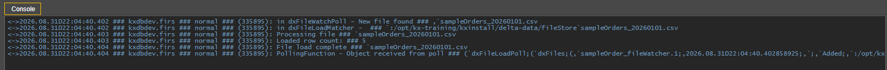

# Lesson 5.6 - Worked Example

_Module 5: Building the File Watcher Data Loader. ~10 min_

> _(Source heading included an author note: "@guan - I am assuming this will be a video as this will need to be represented heavily via visuals" — a recorded video was later added, see below.)_

## Introduction

This lesson goes through the whole process of loading a static CSV file into Delta Control

## Key Concepts

1. Search for the new file watcher in the Process Library Status, right click on the process name or task name and select 'Run'.
2. To be able to see the logging as it is happening, we will connect to the process. To do this, right click on the process again and select 'Connect'. This will open up an Analyst session.
3. Now that our file watcher process is running, our file needs to be moved into the directory that the FW is watching. The sample CSV file we made earlier is copied to DELTADATA_HOME/fileStore. You should see some logging in the Analyst session if you copied the file to the correct directory
   1. Note: if you notice that the file watcher logs that it received a file but does not actually run the analytic, ensure that the file uploaded matches the fileregex value in the config. The file watcher logs every file that gets uploaded to the directories, but only runs the analytics for the ones that have matching fileregex values.
   2. If you get an "analyticnotdefined" error, it means the file watcher process does not have visibility to the loading analytic.
4. If everything works as expected, you should get an output like the below. We can see our logging commands are here alongside some of the logs that auto generated by the file watcher process regardless of what analytic we created.

If you want to read more about data loaders and file watchers, there is a good white paper here on code.kx.com that goes through a full worked example: https://code.kx.com/q/wp/data-loaders/

> **Embedded video in source:** a recorded video titled "File watcher example" is embedded directly in the notebook here (an end-to-end recording, per the reviewer note below). Per your instruction to skip videos for now, this was not downloaded or transcribed; flagging its existence and location for later.

---

> **Reviewer notes from source notebook (not lesson content):**
>
> @guan - use trigger files for large files, coordination of upstream sending files to file watcher directory, I would recommend videos for the e2e, https://code.kx.com/q/wp/data-loaders/
> @Stephen - added link to white paper
> @Stephen - there is no mention of .tgr files in the documentation (it did but didn't explain, this is a trigger file to mark a large file completed creation/download before file watcher should process)
> @Stephen - added video of end to end
