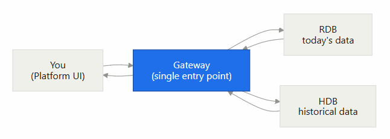
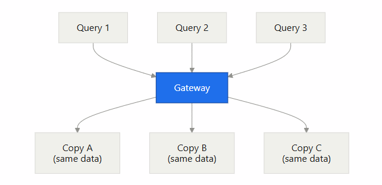
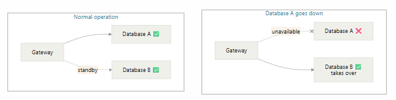

# Lesson 8.1 - What Is a Gateway?

_Module 8: Querying via the Gateway. ~10 min_

## Introduction

This lesson introduces the concept of the Gateway in Delta Platform

## Key Concepts

The system captures data and stores it in more than one place:

- RDB (real time database): holds recent data for today in memory
- HDB (historical database): holds data greater than one day old, lives on disk

Instead of asking the user to send two separate queries to each process, there is a mechanism in place, called the Gateway, that does this for us. The gateway is a single entry point for queries. You simply need to pass it the correct parameters and it will route your query to the correct location(s).

The gateway becomes much more valuable once a system grows. These three ideas are some of the reasons why:

### Sharding: splitting the data

When one process or server cannot comfortably hold or process all the data, you can split the data across several processes or servers to aid performance. Each process, or shard, holds a different slice of data, for example by instrument or region. The benefits of this are:

- Each process query processes faster, as each process is holding less data
- The shards work in parallel, so the total time for a query is roughly the time of the slowest shard rather than the sum of all of them
- The system size is easier to increase, as we can just add shards instead of buying one ever-larger machine

The gateway's role in this is that it directs queries to the necessary shards and merges the partial answers. If the data for a specific query only lives in one shard, then the gateway will only query that shard and not the others. It does add a layer of complexity to the querying, but can significantly increase overall performance.

### Read replicas: copying the data

Similar to sharding, the idea of read replicas is having the same copy of data but in multiple locations. This works well when there are multiple users querying the same data. The gateway can send each user query to a different copy of the data, and it no longer has to wait for one user's query to finish before processing the next. This also enables there to be a separate primary process that facilitates the other operations of the system and can be protected from user queries. Obviously keeping extra copies of the data on disk can be expensive, especially as the data grows, so this would need to be evaluated against the performance gain for the users

### Failover: staying up when something breaks

The gateway can also enable failover, so that when one process or server goes down, another one with the same data takes over and processes the query. This is a common setup in production environments, where there are two servers running with identical copies of the data, and the gateway can switch over to the backup server if there is an issue with the primary one. This generally happens without the user being informed of the switch.

### How the Gateway works

The gateway template provides a single entry point for real-time and historical database queries, provides failover between backend databases, and carries out the aggregations needed across servers before returning the result to the client. So if a query spans over multiple dates including today's date, then the gateway will send a query to both the RDB and the HDB, aggregate the results, and then return the final result to the client/user.

To achieve this, the gateway stores all of the routing information in an in-memory table. When a query comes in, it references this table to be able to find what process it should route the query to. Typically, there will be columns in this table that will act as identifiers to differentiate the different type of databases that exist, e.g. there might be a table column, a region column, asset class column etc.

In addition to having columns to know where to route the query, the gateway's configuration also includes an analytic map, which links each query known to the Gateway to the analytic that actually runs on the backend process. This means that different processes can hold different definitions of the same analytic. For example, a "daily average price" query might read an in-memory table on the RDB but read disk-based partitions on the HDB, with each version written to suit that database. The user only ever sees one query name, and the Gateway takes care of calling the right version on each process and merging the answers. This configuration lives in Delta Control, so it is managed centrally rather than on each server individually.

### Intraday Database (IDB):

In a standard kdb+ tick setup, we only use the RDB and the HDB. The intraday HDB comes in handy when we have a large volume of data coming in on a daily basis, and it becomes too difficult or costly to hold on to for a full day so we write it down to disk at regular intervals. When the data is written down to disk intraday, it is also flushed from memory intraday so that we are not holding on to two copies of the same data. The gateway query logic needs to factor in this new process on the path, and send its requests to the IDB if the user is requesting data that is not contained in the RDB anymore.

---

> **Reviewer notes from source notebook (not lesson content):**
>
> @guan - bring in database engineering concepts, sharding is what you are talking about, but read replica is another concepts where we improve performance with parallel hdbs to service tough queries. If possible ask AI to use mermaid graph to produce example of what I am sharing.
> @ Stephen - done
>
> @guan do you want to mentioned how delta manages this via their gw config design. I believe this is another core design of delta that needs more sharing that is beyond vanilla kdb
> @ Stephen - done
