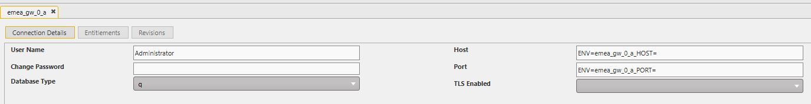

# Lesson 8.2 - Configuring Connections

_Module 8: Querying via the Gateway. ~10 min_

## Introduction

This lesson introduces the concept of connections and what connection groups are

## Key Concepts

A **connection** in KX Control is a saved link to one running kdb+ server (for example, a particular RDB or HDB process). Managing connections in KX Control means you use UI controls instead of the command line. That is why you can do all of this without any backend access. A connection allows you to save the Host and Port details to an entity in Control, so you don't have to remember the Port number every time you want to connect to a particular process

### Connection Groups

Single connections are fine for simple cases, but they have a weakness: if that one server fails, queries to it fail. Connection groups solve this. Connections can be grouped to specify common connection settings for resilience, failover and load balancing, and using groups helps prevent downtime. So for example, you could put the A side and the B side processes in the same connection group, so when the A side is down, the gateway knows to route the query to the B side.

There are a few different ways that a connection group can be setup, and each of them behave slightly differently when they receive a query:

- Round Robin: This method spreads the load across all of the connections. This would be typical if you have a number of HDB processes that all have the same data. It does not matter which one is queried as they would all return the same data
- Leader: This method treats the first connection as the primary and only uses the others if the leader is unavailable. This is typical in a failover setup, where there is a primary side that should be used at all times, but there is a backup (failover) side that can also service the query if the primary side is unavailable / unresponsive.
- Combined: This method queries several databases at once and merges the results

### How connections relate to the gateway

The gateway reaches its databases through a list of servers, hosts and port numbers.
Connections and connection groups are how KX Control describes *where those servers are* and *how they should behave* (for example, which copy to use). A single connection points at one process. If that process fails, whoever relies on it has to switch by hand. A group lets a set of copies behave as one resilient unit, which is why groups are preferred for anything shared.

Here is an example of how we can use user groups to query data. This query (run from the ds_gw_alert_a process) is sending a request to the ds_rdb_alert_a and ds_hdb_alert_a connection groups, which should be setup as Leader. This ensures that queries are not accidentally routed to the failover processes.

![q Scratchpad showing the query `.qr.client.sendRequest["select from dxAction where sym=`dmxServerStateNotification";`ds_rdb_alert`ds_hdb_alert;{[res] myResult::res}; ()!()]` and its console result: a table of date, sym, time, and data columns showing dmxServerStateNotification alert records](images/8.2-connection-group-query-example.png)

---

> **Reviewer notes from source notebook (not lesson content):**
>
> @i know kx dashboard can use the connection group out of box. Have you seen clients use the connection group for API calls? Will be good to add as example so that it is not just theory.
> @Stephen - done
