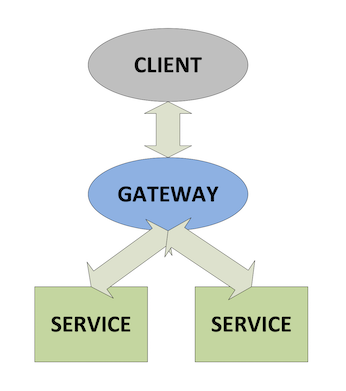

# Lesson 8.4 - Aggregating Results

_Module 8: Querying via the Gateway. ~10 min_

## Introduction

This lesson introduces why some queries need both the RDB and the HDB and how the gateway splits and recombines them

## Key Concepts

If you wanted to answer a query that was looking for "the total traded volume per symbol over the last five days, including today" - neither the RDB or the HDB by themselves would be able to answer this query. You need both databases, combined into one result. This is where the gateway comes in

You can make a single request to the gateway and it will:

- Send the work to each process that holds part of the answer (for the above example, the RDB and the HDB)
- Wait for each process's partial result
- Aggregate the partial results into one combined answer
- Return that single answer to the client / user

If you want more information on gateway design, there is an extensive Whitepaper on the KX website here (link not captured from source — canvas-rendered page, no extractable URL).

### Sync vs Deferred

There are two different ways that a request can be sent to the gateway - synchronously or deferred sync, and each have their uses.

- With a sync request the gateway is busy until your answer is ready, so other users that want to connect to the same gateway will have to wait until your result has been returned.
- With a deferred sync request, the gateway stays free to serve other users while the databases carry out the queries, then returns the aggregated result once all processes have replied. This way a gateway can serve multiple clients at once without being bogged down by a large query.

For most scenarios with more than one user on the system, deferred sync is the friendlier option for everyone sharing the gateway.

---

> **Reviewer notes from source notebook (not lesson content):**
>
> @show an example of the data we have and the function we use. Here we need to make sure delta agg function is also created and there is a pull from rdb, pull from hdb, then perform agg. So maybe do a reference data on rdb (mock) and our ingested data and the agg normalise then aggregate
